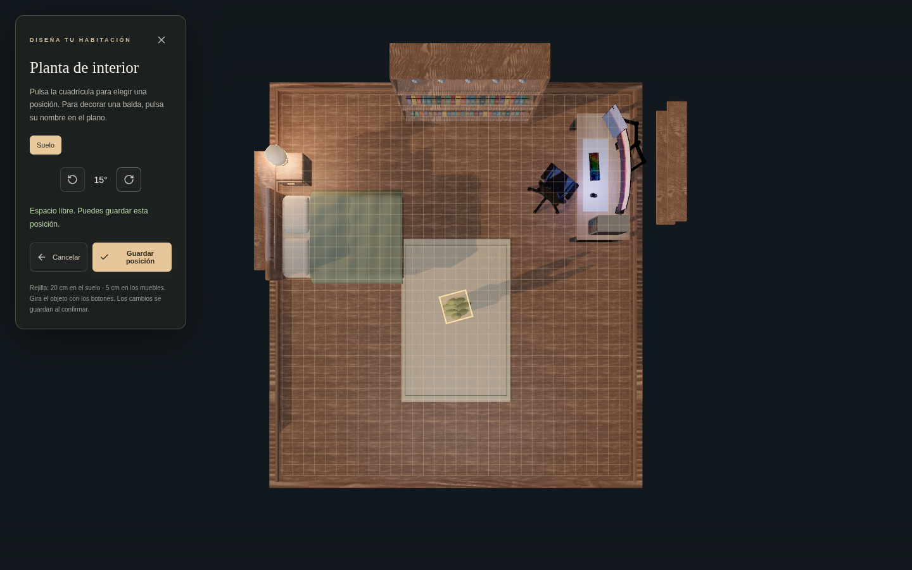
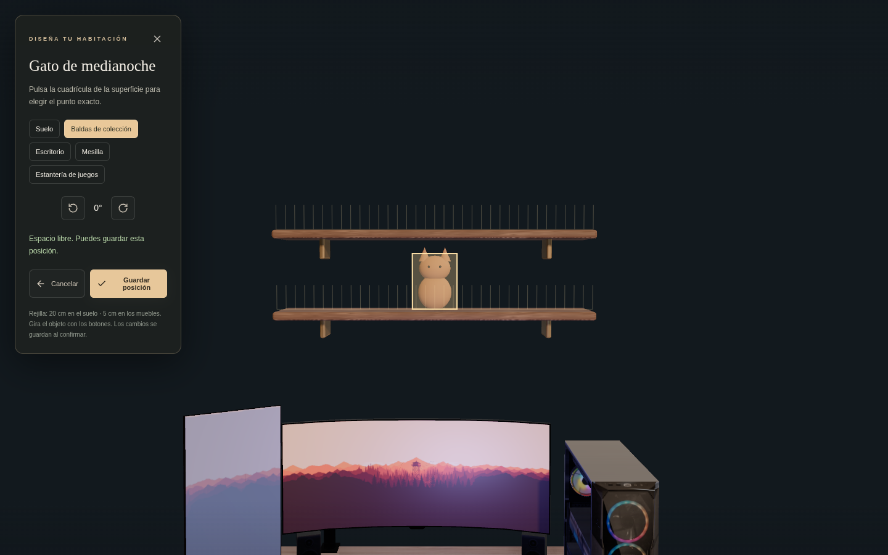
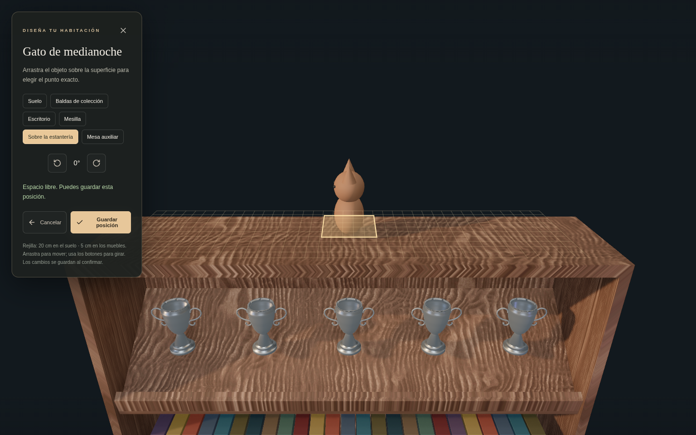
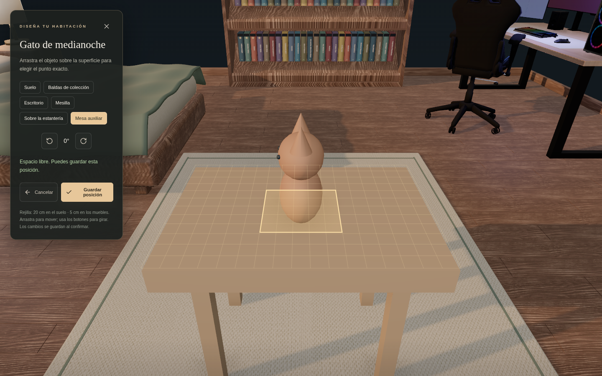
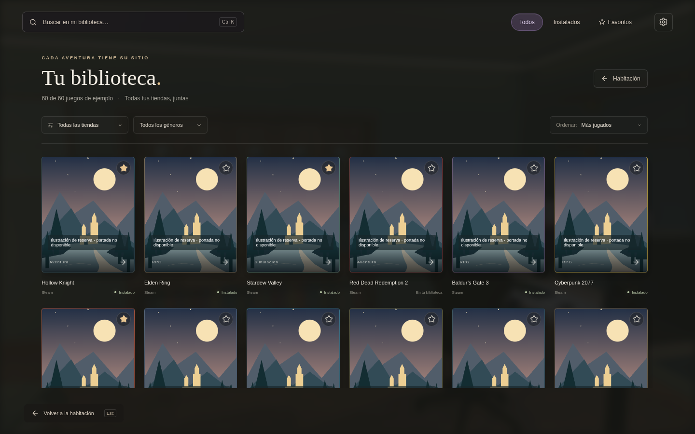
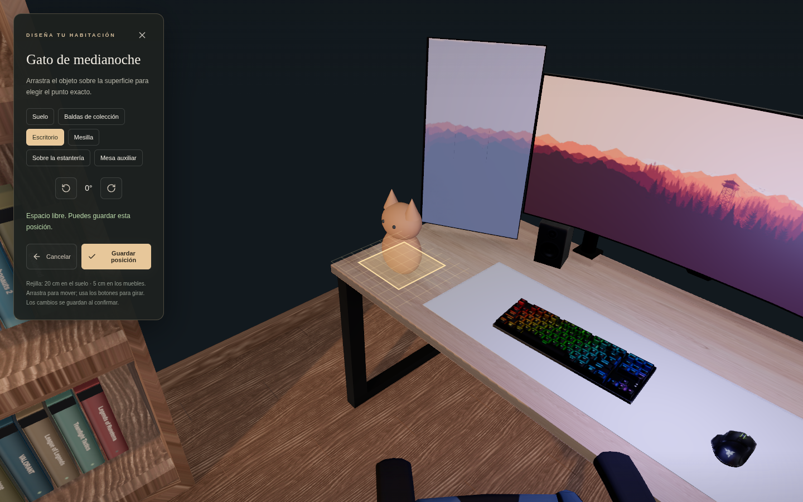

# Mi habitación

Prototipo de launcher para Windows con una habitación **3D real** construida en Blender a partir de los modelos proporcionados. La cámara parte de la entrada y se acerca a la biblioteca. El escenario utiliza `public/models/room.glb`; la antigua imagen `public/room.png` se conserva únicamente como referencia.

## Desarrollo

Requiere Node.js 22.12 o posterior (validado con Node 24) y npm.

```sh
npm ci
npm run dev
```

Abre la dirección que indique Vite, normalmente en el puerto 5173. Deja la terminal abierta. El navegador necesita WebGL 2 y aceleración gráfica. La primera apertura carga aproximadamente 13 MB de geometría y texturas del modelo local.

```sh
npm run build
npm run preview
```

La compilación comprueba TypeScript y crea `dist/`, incluyendo los modelos. Ningún modelo se descarga de una web externa durante el uso de la aplicación.

## Pantalla principal limpia

La entrada centra la vista en la habitación. Los muebles interactivos muestran un contorno ligero al pasar el ratón. Al acercarte a la estantería aparece un botón Biblioteca, que abre la galería completa. La vista general no muestra ese botón. Pulsa el ordenador para abrir la biblioteca, los ajustes, las misiones y el inventario. Ctrl+K abre la búsqueda y Escape vuelve atrás. Los controles de teclado de los muebles solo se muestran al recibir foco.

La personalización se desbloquea con un **kit de 75 puntos**, disponible en los ajustes del ordenador y en la tienda. El kit es una compra única; los cambios de ambiente, paredes y sábanas quedan incluidos. Los puntos siguen siendo locales de demostración.

El inventario ofrece Colocar o Mover objeto. La cámara pasa a una vista cenital con cuadrícula de 20 cm para el suelo. Las baldas se editan de frente, a pasos de 5 cm. Escritorio, mesilla y armario también admiten colocación en superficie. Los botones de giro avanzan 15°. Hay que confirmar Guardar posición; cancelar descarta la propuesta. Se comprueban límites, muebles existentes y solapamiento entre objetos mediante huellas rectangulares conservadoras. Las posiciones antiguas se migran a coordenadas al cargar. Se venden una planta, un taburete y una mesa auxiliar, además de los objetos anteriores.

## Qué puedes probar

- Pulsar el ordenador o cualquier parte del setup para abrir ajustes, tienda, misiones e inventario.
- Acercarte a la estantería y seleccionar cualquiera de los 50 juegos. Los favoritos tienen prioridad; los huecos restantes se ordenan por horas de juego de ejemplo. Los lomos y estrellas se actualizan sobre las cajas 3D.
- Abrir la colección de platinos desde los trofeos del armario. Las fichas incluyen progreso y logros.
- Volver con Escape: ficha → estantería → entrada. Ctrl+K abre el buscador.
- Buscar entre 60 juegos de ejemplo y filtrar por tienda, género, instalación o favoritos.
- Completar misiones, reclamar sus puntos una sola vez, comprar objetos y colocarlos o guardarlos. El patito y la figura del mago utilizan tus GLB importados. El gato, cristal y robot son modelos 3D provisionales creados por la aplicación.
- Cambiar ambiente, color de paredes y ropa de cama. Los cambios afectan a materiales e iluminación 3D. Las preferencias, el inventario y los favoritos se guardan localmente en el navegador.
- Reducir las animaciones. Las interacciones sobre los modelos también tienen botones accesibles mediante teclado.

Si el modelo o WebGL fallan, se ofrece reintentar y se mantiene disponible la biblioteca. No se utiliza una imagen para simular que el 3D ha cargado.

## Ventana de escritorio en Windows

```sh
npm ci
npm run desktop
```

Electron compila y abre la aplicación sin servidor Vite. Sirve exclusivamente los archivos de `dist/` mediante el protocolo local `room://launcher`, que permite cargar los GLB conservando la seguridad del navegador. La interfaz tiene Node desactivado, aislamiento de contexto y sandbox; las ventanas externas y los permisos están bloqueados. La ventana de Windows todavía necesita validación en Windows; las comprobaciones de navegador se realizan en Linux. No hay instalador aún.

## Pruebas

```sh
npx playwright install chromium
npm test
```

En la nube se reutiliza `/usr/bin/chromium` si existe, con SwiftShader para probar WebGL sin GPU física. Las pruebas requieren modelos 3D reales y verifican render, cámara, selección mediante raycasting, biblioteca, persistencia, compras, carga de una figura importada y recuperación tras una descarga GLB fallida. Los resultados no equivalen a una validación de rendimiento con la GPU del usuario.

## Escena y materiales

La distribución aprobada mide 6,6 × 7,2 m y tiene la cama girada junto a la pared izquierda. El setup, armario y copas proceden de los archivos recibidos. La cama continúa siendo provisional porque el ZIP original superaba el límite de transferencia. Los materiales del ordenador y los trofeos quedan pendientes de una pasada visual posterior; la iluminación WebGL puede diferir del render de Blender.

La escena se renderiza bajo demanda: vuelve a dibujar al mover la cámara, cambiar materiales, colocar objetos o redimensionar la ventana. Se limita la densidad de píxeles y se agrupan las lamas del suelo para reducir llamadas de dibujo. Las transiciones respetan la preferencia de accesibilidad.

`blender/entorno-modelos-usuario.zip` contiene la escena editable y el script de montaje. La versión web añade interacciones, lomos y personalización en `src/room3d.tsx`; editar Blender por sí solo no modifica las funciones del launcher.

## Alcance de los datos

Los juegos, las horas, la instalación, los requisitos y los trofeos son **datos de demostración**, no una lectura del ordenador o las cuentas. Las portadas son provisionales. Jugar y Descargar muestran un aviso; no ejecutan procesos ni descargan juegos. Verifica los requisitos en la fuente oficial antes de utilizarlos como información real.

Steam, Epic, Ubisoft, Xbox/Game Pass, EA, Battle.net, Riot y GOG aún no están conectados. El platino es una distinción de esta aplicación al completar su lista de ejemplo, no un trofeo oficial sincronizado.

Los puntos son locales y no tienen valor monetario. Comprar puntos con dinero no está habilitado, no se solicitan credenciales y no se realizan cobros. El backend de cuentas, las integraciones de tiendas, la detección y apertura de juegos y los pagos reales son etapas futuras.

## Iluminación y profundidad

La vista utiliza una luz principal lateral desde la ventana, luces locales cálidas en lámpara y baldas y una aportación fría del monitor. La luz ambiental se mantiene baja para conservar las diferencias entre caras y las sombras. Los modos Atardecer, Noche y Luz suave cambian las intensidades y los colores de estas luces.

Se aplican texturas de madera y lino recuperadas de los archivos proporcionados, con relieve y rugosidad distintos para madera, tejido y metal. El suelo se reconstruye con lamas estrechas y juntas alternadas, agrupadas para reducir llamadas de dibujo. La cámara conserva la vista desde la entrada con un pequeño desplazamiento lateral.

El sombreado de contacto GTAO se calcula al 60 % de resolución y se combina con la imagen completa. Si el navegador no admite render targets de coma flotante, se conserva la iluminación, los materiales, las sombras y el contorno interactivo, omitiendo solo GTAO. Los mapas de sombras se actualizan cuando cambia la geometría o se colocan objetos; no se recalculan solo por mover la cámara.

La cama y las mesillas siguen siendo provisionales mientras se espera una exportación completa del modelo Rhino. Las mejoras de materiales de esta vista no equivalen a convertir ese modelo.

Comparación de la vista general:

| Antes | Ahora |
| --- | --- |
|  |  |

[Ver el ambiente nocturno](docs/launcher-night.png).

Al pasar el ratón por los objetos interactivos, un contorno dorado con brillo marca sus bordes visibles. El efecto no modifica el color ni la emisión de sus materiales y desaparece al retirar el puntero o abrir un diálogo.

## Respuesta del resaltado

La estantería y los juegos utilizan un contorno SVG proyectado desde sus límites, con cuatro lados rectos y un brillo uniforme. El borde no reproduce las irregularidades de la malla. Cambiar de juego actualiza solo ese contorno: no vuelve a ejecutar el render de la habitación ni el sombreado de contacto.

Los movimientos del ratón sobre el canvas se agrupan una vez por fotograma, conservando la última posición, y se comprueban contra volúmenes precalculados. Los botones de juegos actualizan el contorno directamente. Se evitan recorridos de las mallas y actualizaciones de estado React al mover el ratón; los clics sobre el canvas conservan su comprobación precisa de geometría y oclusión. El ordenador y los trofeos también utilizan contornos proyectados de bajo coste. Ningún resaltado necesita ejecutar pases WebGL adicionales.

La prueba de interacción recorre doce juegos con ráfagas de eventos, comprueba que cada contorno cambia y que el contador de renders WebGL permanece igual. Mide por separado el trabajo del manejador; esto no equivale a garantizar una tasa de fotogramas en todos los equipos.

## Biblioteca y pósteres (0.3.1)

El botón Biblioteca junto a la estantería y Ctrl+K abren la biblioteca amplia con búsqueda, filtros y portadas. Las fichas muestran imágenes de Steam u otras fuentes de arte del juego; se cargan directamente desde sus CDN, sin API ni cuentas. Requieren conexión y pueden dejar de estar disponibles. El entorno de desarrollo bloquea el acceso a esos CDN, por lo que no se ha verificado aquí cada portada externa: las pruebas interceptan una respuesta de imagen para verificar su presentación y prueban el fallo de red. Si la imagen no carga, aparece una ilustración local señalada como reserva. No se usa un rectángulo con el título como sustituto de portada.

Para comprobar la versión descargada, abre el ordenador: debe indicar **0.3.1 · Arrastre y vistas de superficies**. Al sustituir un ZIP, detén Vite con Ctrl+C en la terminal anterior, abre una terminal en la carpeta nueva y ejecuta `npm ci` y `npm run dev`. Abre el puerto que indique esa terminal; recarga la página con Ctrl+Shift+R. Abrir otro ZIP no cambia el proyecto que sirve un Vite antiguo.

Vistas del editor y la biblioteca lateral (esta captura simula la falta de conexión a los CDN de portadas):

| Vista cenital | Colocación en baldas |
| --- | --- |
|  |  |

[Referencia del anterior panel lateral](docs/library-dock.png)

## Arrastre y superficies (0.3.1)

Mantén pulsado el botón principal sobre la cuadrícula y arrastra para mover la previsualización. Se mantiene la colocación con un clic. Los movimientos se agrupan por fotograma y se aplican directamente al objeto 3D; React recibe la posición final al soltar. Durante el arrastre se omiten los efectos de posprocesado; al soltar se recuperan las sombras y el render completo. Un borde rojo señala propuestas que no se pueden guardar. La captura del puntero mantiene el arrastre al pasar sobre las etiquetas o salir del canvas, y la cancelación del gesto restaura la propuesta anterior.

Las baldas, la mesilla, el escritorio y la parte superior de la estantería tienen cámaras cercanas para decorar sus superficies. Las etiquetas flotantes solo aparecen en el plano cenital. También se puede decorar la mesa auxiliar y el taburete comprados una vez colocados. Sus adornos acompañan su movimiento y giro, se conservan al recargar y se guardan en el inventario si se retira el mueble que los sostiene. La posición sigue requiriendo Guardar posición; cancelar el editor descarta los cambios.

Vistas de la versión 0.3.1 (las portadas de esta captura usan la reserva sin conexión):

| Sobre la estantería | Mesa comprada |
| --- | --- |
|  |  |




