# Mi habitación

Prototipo de launcher para Windows con una habitación **3D real** construida en Blender a partir de los modelos proporcionados. La cámara parte de la entrada y una puerta conduce a una sala de colección por géneros. El escenario utiliza `public/models/room.glb`; la antigua imagen `public/room.png` se conserva únicamente como referencia.

## Desarrollo

Requiere Node.js 22.12 o posterior (validado con Node 24) y npm.

```sh
npm ci
npm run dev
```

Abre la dirección que indique Vite, normalmente en el puerto 5173. Deja la terminal abierta. El navegador necesita WebGL 2 y aceleración gráfica. La primera apertura carga aproximadamente 13 MB de geometría y texturas del modelo local.

```sh
npm run build
npm run preview
```

La compilación comprueba TypeScript y crea `dist/`, incluyendo los modelos. Ningún modelo se descarga de una web externa durante el uso de la aplicación.

## Pantalla principal limpia

La entrada centra la vista en la habitación. Los muebles interactivos muestran un contorno ligero al pasar el ratón. La puerta Sala de colección abre una segunda habitación ampliada, con estanterías por género, Favoritos y Más jugados. La vista principal conserva la habitación 3D, con suelo, paredes y las dos estanterías centrales. El índice frontal con desplazamiento es opcional. Desde allí se puede abrir la biblioteca completa o filtrada por género. Pulsa el ordenador para abrir la biblioteca, los ajustes, las misiones y el inventario. Ctrl+K abre la búsqueda y Escape vuelve atrás. Los controles de teclado de los muebles solo se muestran al recibir foco.

La personalización se desbloquea con un **kit de 75 puntos**, disponible en los ajustes del ordenador y en la tienda. El kit es una compra única; los cambios de ambiente, paredes y sábanas quedan incluidos. Los puntos siguen siendo locales de demostración.

El inventario ofrece Colocar o Mover objeto. La cámara pasa a una vista cenital con cuadrícula de 20 cm para el suelo. Las baldas se editan de frente, a pasos de 5 cm. Escritorio, mesilla y muebles comprados también admiten colocación en superficie. Los botones de giro avanzan 15°. Hay que confirmar Guardar posición; cancelar descarta la propuesta. Se comprueban límites, muebles existentes y solapamiento entre objetos mediante huellas rectangulares conservadoras. Las posiciones antiguas se migran a coordenadas al cargar. Se venden una planta, un taburete y una mesa auxiliar, además de los objetos anteriores.

## Qué puedes probar

- Pulsar el ordenador o cualquier parte del setup para abrir ajustes, tienda, misiones e inventario.
- Entrar por la puerta en la sala de colección, elegir un género y seleccionar sus portadas frontales. La vista general ofrece dos portadas grandes por mueble; al acercarte aparecen hasta ocho. Los demás juegos están en la biblioteca filtrada.
- Abrir Mis platinos desde el ordenador. Las fichas incluyen progreso y logros.
- Volver con Escape: ficha → sala de colección → entrada. Ctrl+K abre el buscador.
- Buscar entre 60 juegos de ejemplo y filtrar por tienda, género, instalación o favoritos.
- Completar misiones, reclamar sus puntos una sola vez, comprar objetos y colocarlos o guardarlos. El patito y la figura del mago utilizan tus GLB importados. El gato, cristal y robot son modelos 3D provisionales creados por la aplicación.
- Cambiar ambiente, color de paredes y ropa de cama. Los cambios afectan a materiales e iluminación 3D. Las preferencias, el inventario y los favoritos se guardan localmente en el navegador.
- Reducir las animaciones. Las interacciones sobre los modelos también tienen botones accesibles mediante teclado.

Si el modelo o WebGL fallan, se ofrece reintentar y se mantiene disponible la biblioteca. No se utiliza una imagen para simular que el 3D ha cargado.

## Ventana de escritorio en Windows

```sh
npm ci
npm run desktop
```

Electron compila y abre la aplicación sin servidor Vite. Sirve exclusivamente los archivos de `dist/` mediante el protocolo local `room://launcher`, que permite cargar los GLB conservando la seguridad del navegador. La interfaz tiene Node desactivado, aislamiento de contexto y sandbox; las ventanas externas y los permisos están bloqueados. La ventana de Windows todavía necesita validación en Windows; las comprobaciones de navegador se realizan en Linux. No hay instalador aún.

## Pruebas

```sh
npx playwright install chromium
npm test
```

En la nube se reutiliza `/usr/bin/chromium` si existe, con SwiftShader para probar WebGL sin GPU física. Las pruebas requieren modelos 3D reales y verifican render, cámara, selección mediante raycasting, biblioteca, persistencia, compras, carga de una figura importada y recuperación tras una descarga GLB fallida. Los resultados no equivalen a una validación de rendimiento con la GPU del usuario.

## Escena y materiales

La distribución aprobada mide 6,6 × 7,2 m y tiene la cama girada junto a la pared izquierda. El setup, armario y copas proceden de los archivos recibidos. La cama continúa siendo provisional porque el ZIP original superaba el límite de transferencia. Los materiales del ordenador y los trofeos quedan pendientes de una pasada visual posterior; la iluminación WebGL puede diferir del render de Blender.

La escena se renderiza bajo demanda: vuelve a dibujar al mover la cámara, cambiar materiales, colocar objetos o redimensionar la ventana. Se limita la densidad de píxeles y se agrupan las lamas del suelo para reducir llamadas de dibujo. Las transiciones respetan la preferencia de accesibilidad.

`blender/entorno-modelos-usuario.zip` contiene la escena editable y el script de montaje. La versión web añade interacciones, lomos y personalización en `src/room3d.tsx`; editar Blender por sí solo no modifica las funciones del launcher.

## Alcance de los datos

Los juegos, las horas, la instalación, los requisitos y los trofeos son **datos de demostración**, no una lectura del ordenador o las cuentas. Las portadas son provisionales. Jugar y Descargar muestran un aviso; no ejecutan procesos ni descargan juegos. Verifica los requisitos en la fuente oficial antes de utilizarlos como información real.

Steam, Epic, Ubisoft, Xbox/Game Pass, EA, Battle.net, Riot y CD PROJEKT RED aún no están vinculados. CD PROJEKT RED ofrece accesos a su portal oficial de cuenta. El platino es una distinción de esta aplicación al completar su lista de ejemplo, no un trofeo oficial sincronizado.

Los puntos son locales y no tienen valor monetario. Comprar puntos con dinero no está habilitado, no se solicitan credenciales y no se realizan cobros. El backend de cuentas, las integraciones de tiendas, la detección y apertura de juegos y los pagos reales son etapas futuras.

## Iluminación y profundidad

La vista utiliza una luz principal lateral desde la ventana, luces locales cálidas en lámpara y baldas y una aportación fría del monitor. La luz ambiental se mantiene baja para conservar las diferencias entre caras y las sombras. Los modos Atardecer, Noche y Luz suave cambian las intensidades y los colores de estas luces.

Se aplican texturas de madera y lino recuperadas de los archivos proporcionados, con relieve y rugosidad distintos para madera, tejido y metal. El suelo se reconstruye con lamas estrechas y juntas alternadas, agrupadas para reducir llamadas de dibujo. La cámara conserva la vista desde la entrada con un pequeño desplazamiento lateral.

El sombreado de contacto GTAO se calcula al 60 % de resolución y se combina con la imagen completa. Si el navegador no admite render targets de coma flotante, se conserva la iluminación, los materiales, las sombras y el contorno interactivo, omitiendo solo GTAO. Los mapas de sombras se actualizan cuando cambia la geometría o se colocan objetos; no se recalculan solo por mover la cámara.

La cama y las mesillas siguen siendo provisionales mientras se espera una exportación completa del modelo Rhino. Las mejoras de materiales de esta vista no equivalen a convertir ese modelo.

Comparación de la vista general:

| Antes | Ahora |
| --- | --- |
|  |  |

[Ver el ambiente nocturno](docs/launcher-night.png).

Al pasar el ratón por los objetos interactivos, un contorno dorado con brillo marca sus bordes visibles. El efecto no modifica el color ni la emisión de sus materiales y desaparece al retirar el puntero o abrir un diálogo.

## Respuesta del resaltado

La estantería y los juegos utilizan un contorno SVG proyectado desde sus límites, con cuatro lados rectos y un brillo uniforme. El borde no reproduce las irregularidades de la malla. Cambiar de juego actualiza solo ese contorno: no vuelve a ejecutar el render de la habitación ni el sombreado de contacto.

Los movimientos del ratón sobre el canvas se agrupan una vez por fotograma, conservando la última posición, y se comprueban contra volúmenes precalculados. Los botones de juegos actualizan el contorno directamente. Se evitan recorridos de las mallas y actualizaciones de estado React al mover el ratón; los clics sobre el canvas conservan su comprobación precisa de geometría y oclusión. El ordenador utiliza una silueta calculada una vez por cámara y tamaño de ventana, sin iluminación ni posprocesado. Al pasar el ratón se muestra su imagen de contorno guardada, incluidos los huecos entre patas y silla. Los juegos y la estantería mantienen sus contornos ligeros; ningún movimiento del ratón vuelve a renderizar la habitación.

La prueba de interacción recorre doce juegos con ráfagas de eventos, comprueba que cada contorno cambia y que el contador de renders WebGL permanece igual. Mide por separado el trabajo del manejador; esto no equivale a garantizar una tasa de fotogramas en todos los equipos.

## Biblioteca y pósteres (0.3.1)

El botón Biblioteca junto a la estantería y Ctrl+K abren la biblioteca amplia con búsqueda, filtros y portadas. Las fichas muestran imágenes de Steam u otras fuentes de arte del juego; se cargan directamente desde sus CDN, sin API ni cuentas. Requieren conexión y pueden dejar de estar disponibles. El entorno de desarrollo bloquea el acceso a esos CDN, por lo que no se ha verificado aquí cada portada externa: las pruebas interceptan una respuesta de imagen para verificar su presentación y prueban el fallo de red. Si la imagen no carga, aparece una ilustración local señalada como reserva. No se usa un rectángulo con el título como sustituto de portada.

Para comprobar la versión descargada, abre el ordenador: debe indicar **0.3.2 · Carátulas y siluetas**. Al sustituir un ZIP, detén Vite con Ctrl+C en la terminal anterior, abre una terminal en la carpeta nueva y ejecuta `npm ci` y `npm run dev`. Abre el puerto que indique esa terminal; recarga la página con Ctrl+Shift+R. Abrir otro ZIP no cambia el proyecto que sirve un Vite antiguo.

Vistas del editor y la biblioteca lateral (esta captura simula la falta de conexión a los CDN de portadas):

| Vista cenital | Colocación en baldas |
| --- | --- |
|  |  |

[Referencia del anterior panel lateral](docs/library-dock.png)

## Arrastre y superficies (0.3.1)

Mantén pulsado el botón principal sobre la cuadrícula y arrastra para mover la previsualización. Se mantiene la colocación con un clic. Los movimientos se agrupan por fotograma y se aplican directamente al objeto 3D; React recibe la posición final al soltar. Durante el arrastre se omiten los efectos de posprocesado; al soltar se recuperan las sombras y el render completo. Un borde rojo señala propuestas que no se pueden guardar. La captura del puntero mantiene el arrastre al pasar sobre las etiquetas o salir del canvas, y la cancelación del gesto restaura la propuesta anterior.

Las baldas, la mesilla, el escritorio y la parte superior de la estantería tienen cámaras cercanas para decorar sus superficies. Las etiquetas flotantes solo aparecen en el plano cenital. También se puede decorar la mesa auxiliar y el taburete comprados una vez colocados. Sus adornos acompañan su movimiento y giro, se conservan al recargar y se guardan en el inventario si se retira el mueble que los sostiene. La posición sigue requiriendo Guardar posición; cancelar el editor descarta los cambios.

Vistas de la versión 0.3.1 (las portadas de esta captura usan la reserva sin conexión):

| Sobre la estantería | Mesa comprada |
| --- | --- |
|  |  |


## Carátulas, lomos y siluetas (0.3.2)

Biblioteca queda centrado bajo la estantería en la vista cercana. El encuadre deja espacio inferior para el botón. La ficha y las tarjetas utilizan proporción vertical 2:3 y `object-fit: contain`, mostrando toda la ilustración sin deformarla ni recortar títulos. Las imágenes horizontales de reserva conservan su proporción y dejan márgenes.

Los lomos incluyen una pequeña ilustración completa y un fondo impreso derivado del arte, con el título vertical. Sus imágenes se cargan de forma asíncrona, se reducen para ahorrar memoria y se comparten entre actualizaciones. Los cambios de ambiente no repiten sus descargas. Sin arte disponible se conserva un diseño ilustrado local; para usar imágenes como texturas el servidor debe admitir CORS. Las actualizaciones de texturas se agrupan y se posponen mientras se recorren juegos con el ratón.

La biblioteca y la ficha prueban fuentes alternativas de Steam antes de usar la reserva. La ficha permite Reintentar. Minecraft, Hearthstone, los títulos de Riot y Fortnite dependen de otras fuentes externas; algunas direcciones siguen sin estar verificadas y pueden fallar aunque Steam funcione. No se afirma que todas las carátulas estén reparadas o disponibles sin conexión. El paisaje de reserva indica un fallo de carga de la imagen, no que falte el juego ni su licencia.

El contorno del setup se obtiene de una máscara plana de sus mallas y se guarda como PNG transparente. Ese cálculo se repite al cambiar cámara o ventana, no al mover el ratón. La estantería conserva un reborde liso para no reproducir las irregularidades de su modelo.

Capturas de 0.3.2 sin conexión a las fuentes de arte (se ven diseños e ilustraciones de reserva):

| Silueta del setup | Biblioteca bajo el mueble |
| --- | --- |
| 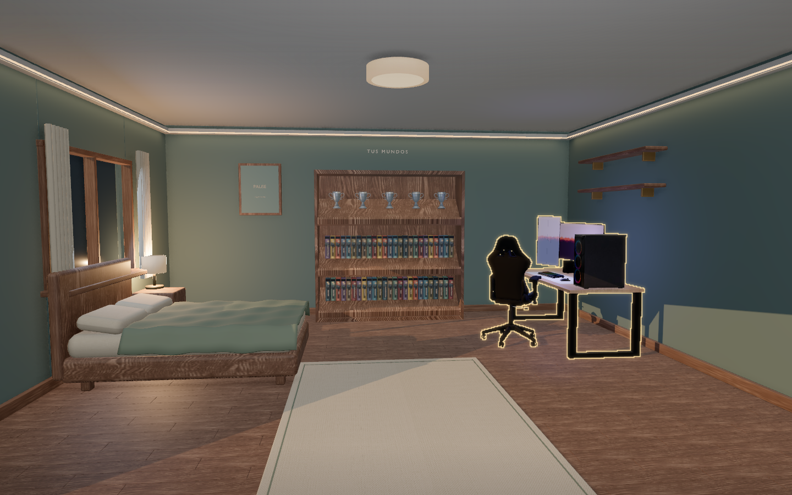 | 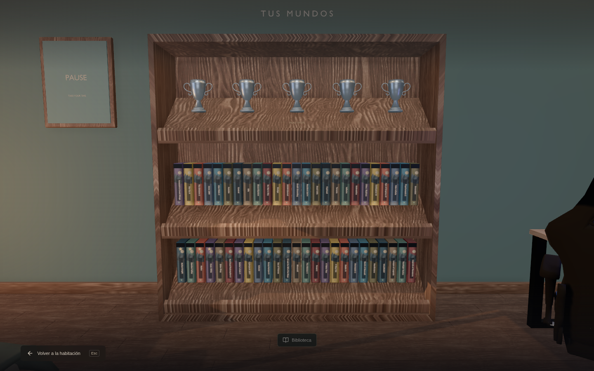 |

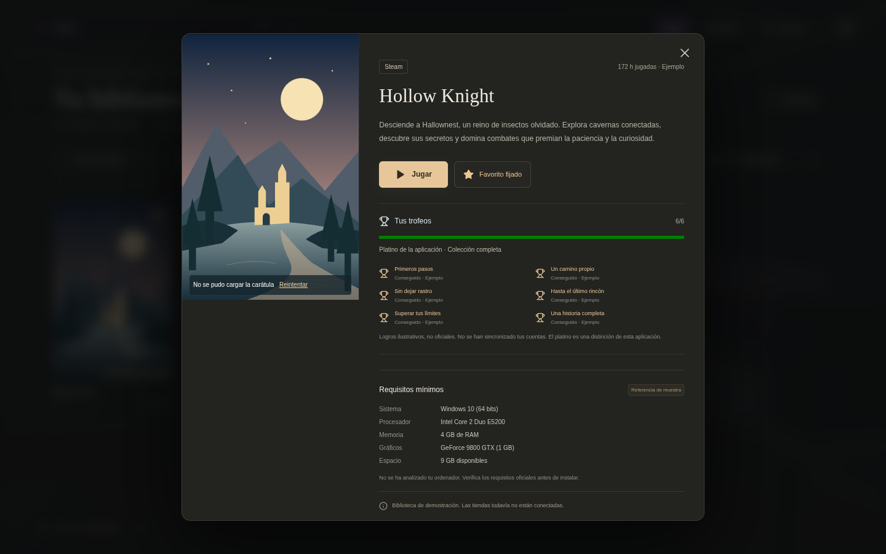

## Fichas ampliadas (0.4.0)

Las fichas tienen pestañas Información, Tu actividad y Galería. Se muestran tienda e instalación, géneros, mando, modos, número de jugadores cuando se conoce, idiomas y disponibilidad de voces/subtítulos. Las horas, logros e instalación siguen siendo ejemplos; última partida, tamaño de descarga y tamaño instalado no se inventan y quedan sin confirmar hasta conectar cuentas y detectar instalaciones.

Los juegos con un identificador Steam pueden consultar su ficha pública mediante `/api/store-details/:id`. El servidor de Vite (desarrollo y preview) y el protocolo local de Electron implementan esta ruta con destino fijo, ID numérico, timeout, caché acotada, texto sin HTML y medios HTTPS de CDN conocidos. La fuente Steam se identifica incluso cuando el juego está en otra tienda, pues las ediciones pueden diferir. No hay autenticación ni acceso a las bibliotecas privadas. En hosting estático sin esa ruta, o sin conexión, se mantiene la ficha y el botón de reintento.

La galería carga hasta seis capturas y dos tráileres que devuelva Steam. Las capturas se pueden ampliar y los vídeos usan controles, sin reproducción automática ni precarga. No todos los juegos proporcionan material. Abrir en la tienda conduce a su ficha o catálogo oficial; Electron permite abrir únicamente dominios de tiendas explícitamente admitidos en el navegador del sistema. Las partidas y logros no se comparten ni se suman entre plataformas.

Validación: compilación de producción, dos pruebas de navegador con datos de tienda simulados, fallo de red y reintento; comprobación del saneamiento de la respuesta y rechazo de IDs inválidos. La consulta real a cada tienda y la ventana de Electron en Windows quedan sin verificar en este entorno.

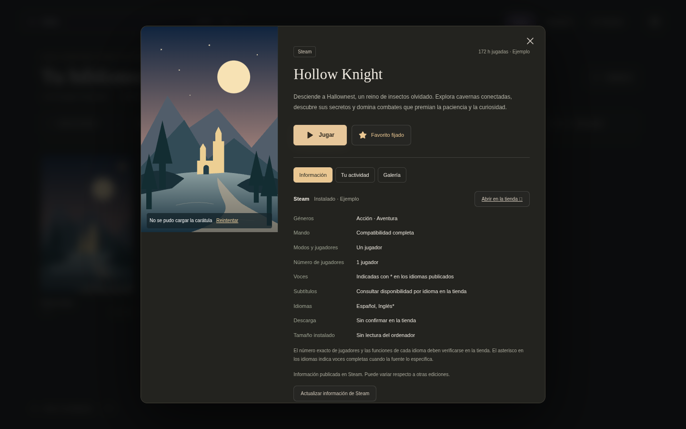

## Lomos legibles (0.4.1)

Se eliminan las miniportadas repetidas y se amplía el título vertical. Las texturas pasan a 192 × 1024, con filtrado anisotrópico; el arte fuente se reduce a 256 píxeles de ancho para no mantener todas las imágenes a tamaño completo. Al señalar o enfocar un juego aparece una carátula lateral completa, sin alterar el render 3D. La previsualización mantiene una ilustración de reserva mientras llega la imagen. Las fuentes externas y sus limitaciones de disponibilidad siguen siendo las mismas.

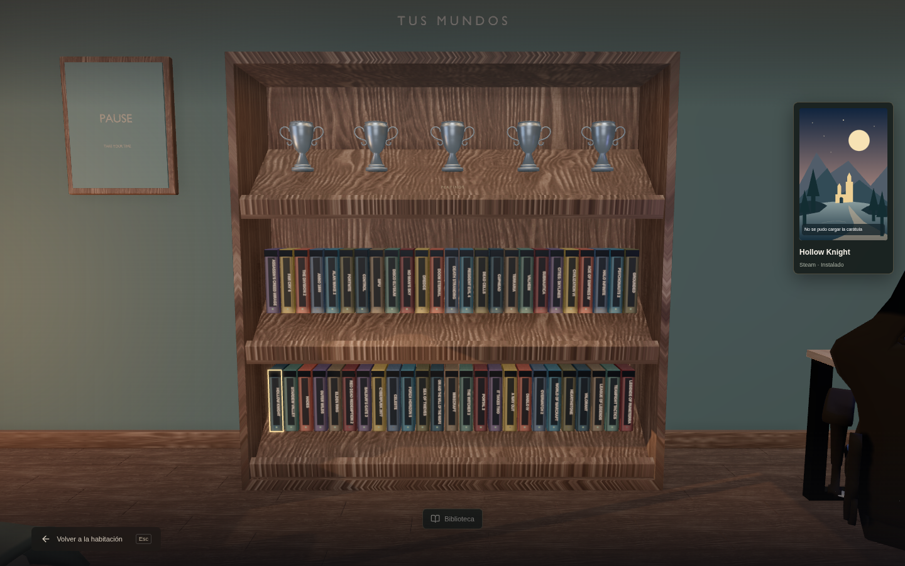

## Cajas de colección (0.4.2)

Los lomos tienen un inserto claro u oscuro, bandas azules y texto vertical de alto contraste, con una franja del arte cuando está disponible. La vista previa conserva la carátula completa. La captura muestra el diseño sin conexión a las fuentes de arte.

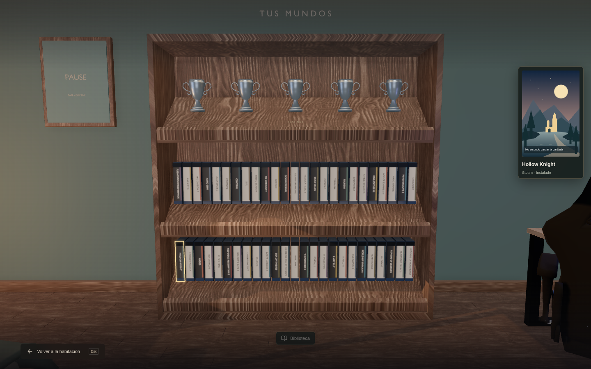

En la versión 0.4.3 todos los lomos usan un fondo oscuro con texto claro. La franja sigue mostrando arte cuando se puede cargar; no representa el diseño original del lomo físico.


## Sala de colección y cuenta RED (0.5.0)

La estantería principal y sus juegos desaparecen del dormitorio. Una puerta abre una nueva sala 3D con doce estanterías, una por cada género de los 60 juegos de demostración. Las cajas se muestran de frente, con un máximo de cuatro por estantería. Seleccionar un rótulo o el selector de géneros acerca la cámara a esa estantería. Si una portada mide menos de 65 × 98 píxeles en pantalla, se oculta en lugar de mostrar una miniatura ilegible. El pie de la vista de género ofrece Ver biblioteca de ese género; abre el catálogo completo, restablece los otros filtros y mantiene solo el género elegido. Biblioteca completa y Ctrl+K siguen disponibles.

La sala usa geometría ligera y madera local. La imagen se actualiza al cambiar cámara, tamaño o texturas; señalar una portada no redibuja el 3D. Las portadas mantienen su proporción y se proyectan sobre la cara frontal de cada caja. Requieren acceso a sus CDN; si fallan, aparece la ilustración local con el nombre del juego. Los adornos colocados sobre el armario retirado vuelven al inventario, conservando su propiedad y los puntos. Mis platinos pasa al menú del ordenador.

GOG se sustituye en la interfaz por CD PROJEKT RED. Los ejemplos de The Witcher 3 y Cyberpunk 2077 se agrupan en esa plataforma; Disco Elysium queda en Steam. Crear cuenta e Iniciar sesión abren `https://accounts.cdprojektred.com/` en el navegador del sistema, donde se elige el flujo correspondiente. No se capturan credenciales, no se simula una sesión iniciada y no se sincronizan cuentas ni bibliotecas. Para vincular RED al launcher sigue siendo necesaria una integración oficial de autenticación. El acceso de red a ese portal no pudo verificarse desde este entorno.


Capturas de 0.5.0 con las descargas de imágenes externas bloqueadas para comprobar la reserva sin conexión:

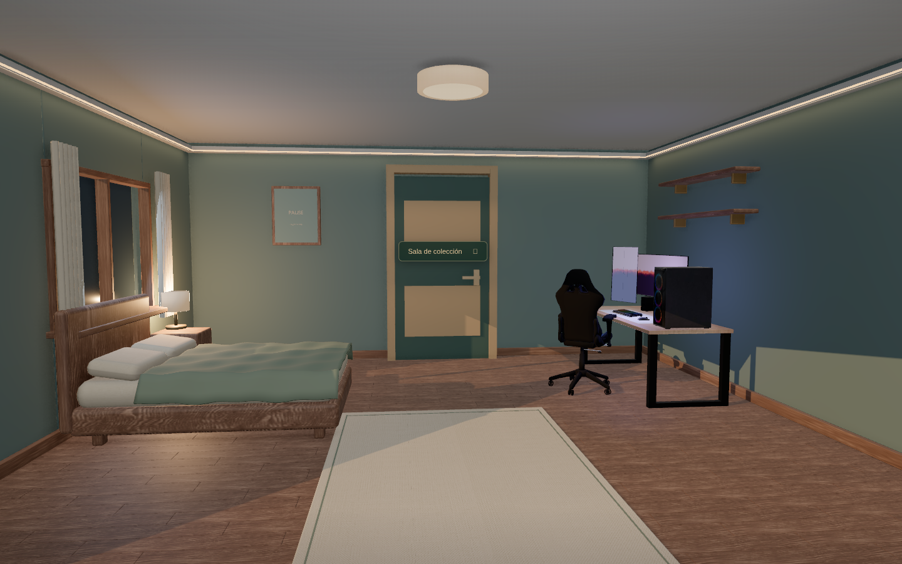

| Vista de la sala | Estantería de un género |
| --- | --- |
| 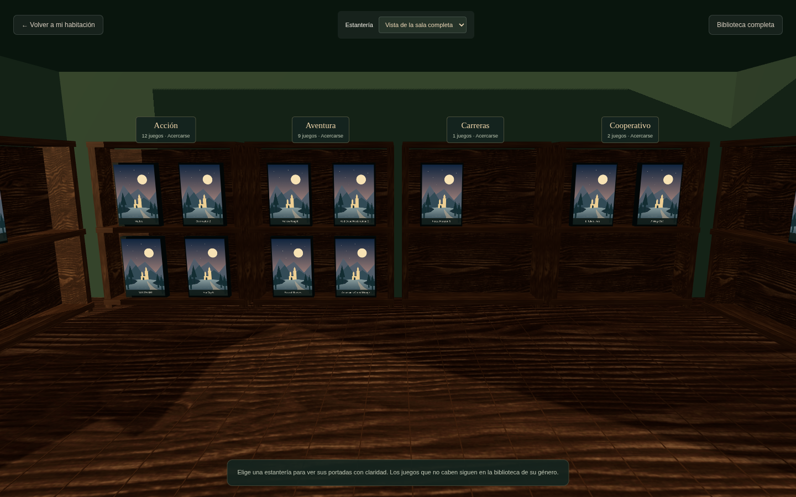 | 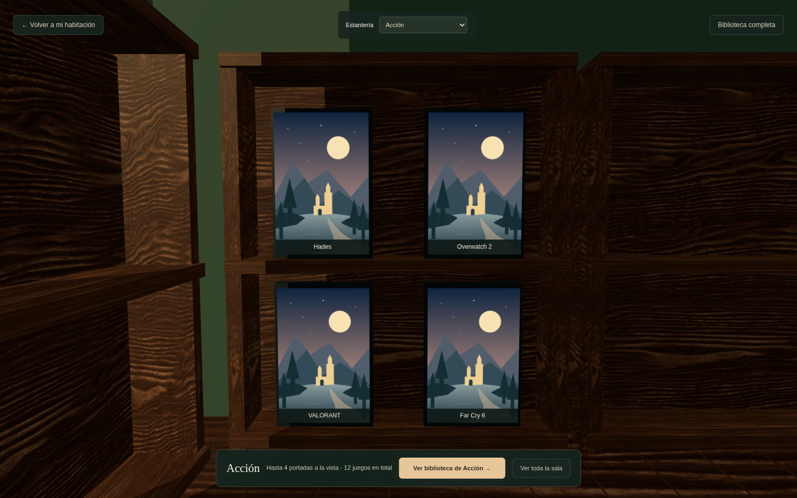 |


## Estanterías ampliadas y vista frontal (0.6.0)

La sala pasa a 19,6 × 21 m y los muebles a unos 4,24 m de ancho, con capacidad para ocho cajas en dos filas. Se incorporan dos estanterías en la zona central: Favoritos y Más jugados. Favoritos utiliza las estrellas guardadas y se actualiza al cambiarlas desde una ficha; Más jugados ordena por las horas del catálogo, que siguen siendo datos de ejemplo. Sus botones Biblioteca abren respectivamente el filtro Favoritos y el catálogo ordenado por Más jugados.

La vista general elegida es frontal y tiene desplazamiento vertical. Ofrece las catorce estanterías, con las dos centrales al principio. Cada previsualización muestra dos portadas grandes; Ver estantería muestra hasta ocho y mantiene el acceso al catálogo completo de esa sección. El encuadre se adapta a la ventana sin ocultar las cajas por un umbral de píxeles, por lo que entrar o salir de F11 no cambia qué juegos aparecen. Las imágenes se precargan al entrar la estantería en la zona visible. La vista general usa un solo canvas con cámaras frontales, se renderiza al cambiar contenido o tamaño y conserva la resolución original de las portadas HTML. Se limita la resolución del fondo 3D para acotar la memoria de vistas largas.

Validación: compilación de producción y ocho pruebas de navegador. Incluyen entrada a 1600 × 770 sin redimensionar, recorrido de las catorce estanterías, carga de sus imágenes, cambio a 1600 × 900 y vuelta, ventana compacta, favoritos que cambian al quitar estrellas, orden de más jugados, biblioteca filtrada, inventario y recuperación sin WebGL. Se usa una ilustración de prueba para verificar la carga y el encuadre; las fuentes reales de carátulas siguen dependiendo de sus servidores externos.

Capturas de validación con ilustraciones de prueba inyectadas únicamente por Playwright:

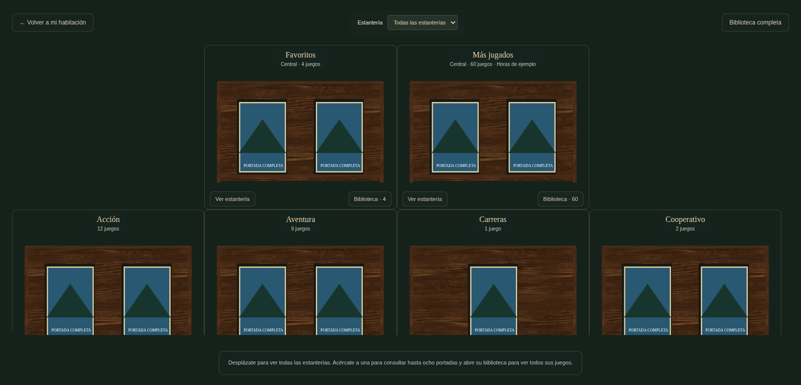

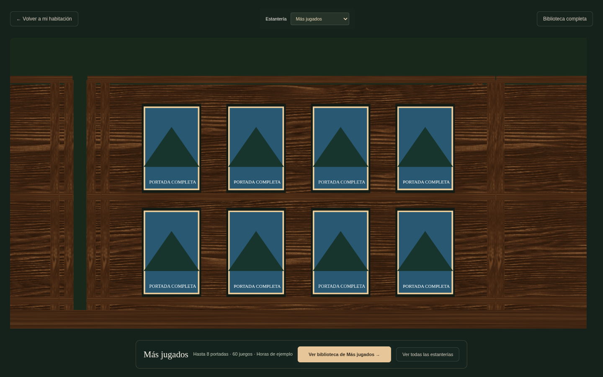


## Habitación 3D como vista principal (0.6.1)

Entrar por la puerta vuelve a mostrar la sala 3D completa, con suelo, paredes, iluminación y los muebles situados en el espacio. Se mantienen las estanterías ampliadas por género y las dos centrales de Favoritos y Más jugados. La vista general permite mirar arrastrando y ampliar con la rueda; Centro, Fondo, Izquierda y Derecha ofrecen encuadres de cada zona. Pulsar un rótulo acerca su estantería y muestra hasta ocho portadas.

Índice frontal abre explícitamente la vista con desplazamiento de 0.6.0; Sala 3D regresa a la habitación. El dormitorio original permanece accesible mediante Volver a mi habitación. Las imágenes se proyectan sobre los objetos y se ocultan detrás de otras estanterías cuando corresponde, sin depender del umbral de tamaño que obligaba a usar F11. La cámara se actualiza bajo demanda y las sombras no se recalculan por cada movimiento del ratón.

Validación: nueve pruebas de navegador que cubren la entrada 3D por defecto, cambio de vistas y arrastre, índice opcional, vuelta al dormitorio, favoritos, más jugados, filtros, tamaño compacto y recuperación sin WebGL; compilación de producción. Las capturas siguientes usan portadas de prueba inyectadas por Playwright:

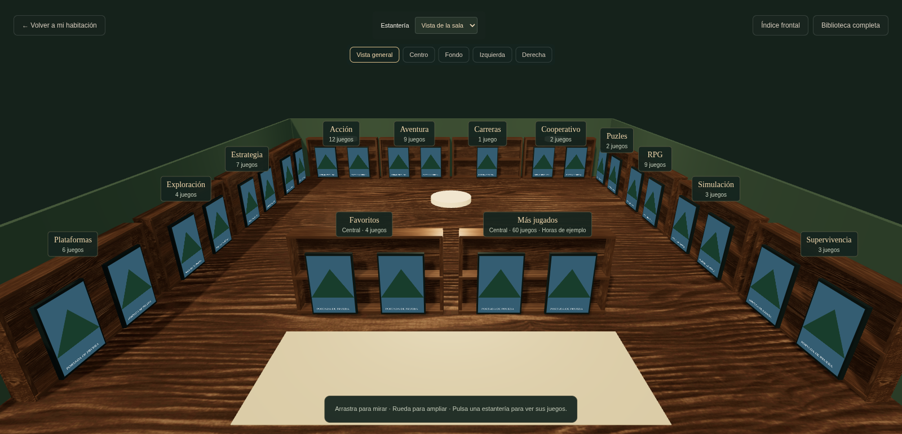

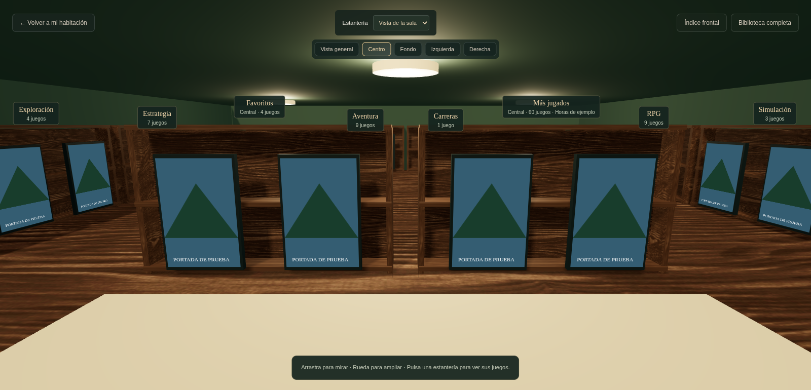
