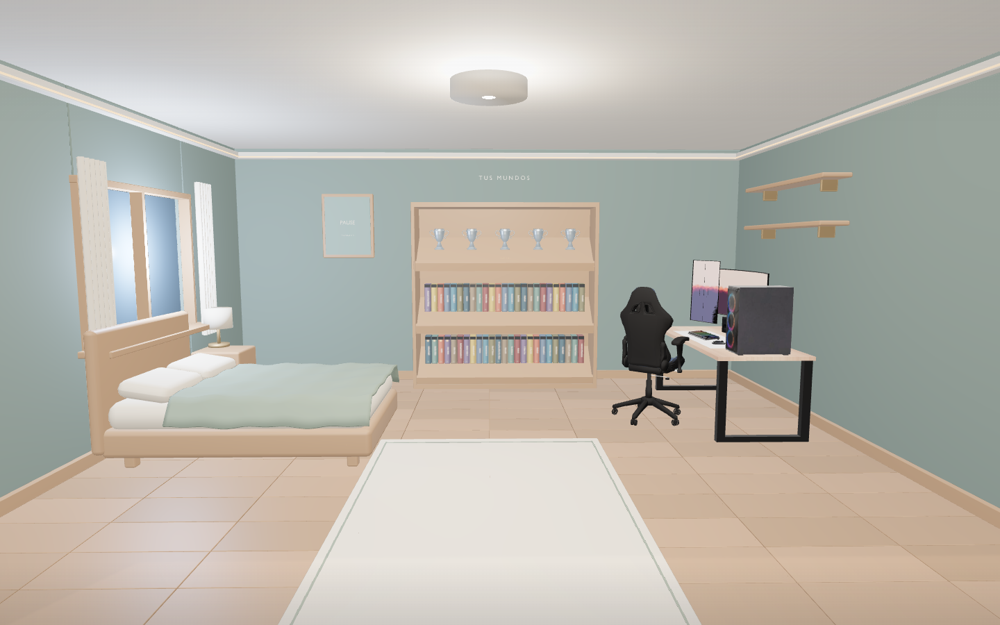

# Mi habitación

Prototipo de launcher para Windows con una habitación **3D real** construida en Blender a partir de los modelos proporcionados. La cámara parte de la entrada y se acerca a la biblioteca. El escenario utiliza `public/models/room.glb`; la antigua imagen `public/room.png` se conserva únicamente como referencia.

## Desarrollo

Requiere Node.js 22.12 o posterior (validado con Node 24) y npm.

```sh
npm ci
npm run dev
```

Abre la dirección que indique Vite, normalmente en el puerto 5173. Deja la terminal abierta. El navegador necesita WebGL 2 y aceleración gráfica. La primera apertura carga aproximadamente 13 MB de geometría y texturas del modelo local.

```sh
npm run build
npm run preview
```

La compilación comprueba TypeScript y crea `dist/`, incluyendo los modelos. Ningún modelo se descarga de una web externa durante el uso de la aplicación.

## Pantalla principal limpia

La entrada muestra únicamente la habitación. Los muebles interactivos se iluminan al pasar el ratón, sin etiquetas flotantes. Pulsa el ordenador para abrir la biblioteca, los ajustes, las misiones y el inventario. Ctrl+K abre la búsqueda y Escape vuelve atrás. Los controles de teclado solo se muestran al recibir foco.

La personalización se desbloquea con un **kit de 75 puntos**, disponible en los ajustes del ordenador y en la tienda. El kit es una compra única; los cambios de ambiente, paredes y sábanas quedan incluidos. Los puntos siguen siendo locales de demostración.

En el inventario, cada objeto tiene selectores de sitio y orientación (0°, 90°, 180°, 270°). Se puede elegir entre once huecos predefinidos en baldas, escritorio, mesilla y armario. Los huecos ocupados se bloquean para evitar superposiciones. Posición y orientación se conservan al recargar; todavía no hay arrastre libre por cualquier superficie.

## Qué puedes probar

- Pulsar el ordenador o cualquier parte del setup para abrir ajustes, tienda, misiones e inventario.
- Acercarte a la estantería y seleccionar cualquiera de los 50 juegos. Los favoritos tienen prioridad; los huecos restantes se ordenan por horas de juego de ejemplo. Los lomos y estrellas se actualizan sobre las cajas 3D.
- Abrir la colección de platinos desde los trofeos del armario. Las fichas incluyen progreso y logros.
- Volver con Escape: ficha → estantería → entrada. Ctrl+K abre el buscador.
- Buscar entre 60 juegos de ejemplo y filtrar por tienda, género, instalación o favoritos.
- Completar misiones, reclamar sus puntos una sola vez, comprar objetos y colocarlos o guardarlos. El patito y la figura del mago utilizan tus GLB importados. El gato, cristal y robot son modelos 3D provisionales creados por la aplicación.
- Cambiar ambiente, color de paredes y ropa de cama. Los cambios afectan a materiales e iluminación 3D. Las preferencias, el inventario y los favoritos se guardan localmente en el navegador.
- Reducir las animaciones. Las interacciones sobre los modelos también tienen botones accesibles mediante teclado.

Si el modelo o WebGL fallan, se ofrece reintentar y se mantiene disponible la biblioteca. No se utiliza una imagen para simular que el 3D ha cargado.

## Ventana de escritorio en Windows

```sh
npm ci
npm run desktop
```

Electron compila y abre la aplicación sin servidor Vite. Sirve exclusivamente los archivos de `dist/` mediante el protocolo local `room://launcher`, que permite cargar los GLB conservando la seguridad del navegador. La interfaz tiene Node desactivado, aislamiento de contexto y sandbox; las ventanas externas y los permisos están bloqueados. La ventana de Windows todavía necesita validación en Windows; las comprobaciones de navegador se realizan en Linux. No hay instalador aún.

## Pruebas

```sh
npx playwright install chromium
npm test
```

En la nube se reutiliza `/usr/bin/chromium` si existe, con SwiftShader para probar WebGL sin GPU física. Las pruebas requieren modelos 3D reales y verifican render, cámara, selección mediante raycasting, biblioteca, persistencia, compras, carga de una figura importada y recuperación tras una descarga GLB fallida. Los resultados no equivalen a una validación de rendimiento con la GPU del usuario.

## Escena y materiales

La distribución aprobada mide 6,6 × 7,2 m y tiene la cama girada junto a la pared izquierda. El setup, armario y copas proceden de los archivos recibidos. La cama continúa siendo provisional porque el ZIP original superaba el límite de transferencia. Los materiales del ordenador y los trofeos quedan pendientes de una pasada visual posterior; la iluminación WebGL puede diferir del render de Blender.

La escena se renderiza bajo demanda: vuelve a dibujar al mover la cámara, cambiar materiales, colocar objetos o redimensionar la ventana. Se limita la densidad de píxeles y se agrupan las lamas del suelo para reducir llamadas de dibujo. Las transiciones respetan la preferencia de accesibilidad.

`blender/entorno-modelos-usuario.zip` contiene la escena editable y el script de montaje. La versión web añade interacciones, lomos y personalización en `src/room3d.tsx`; editar Blender por sí solo no modifica las funciones del launcher.

## Alcance de los datos

Los juegos, las horas, la instalación, los requisitos y los trofeos son **datos de demostración**, no una lectura del ordenador o las cuentas. Las portadas son provisionales. Jugar y Descargar muestran un aviso; no ejecutan procesos ni descargan juegos. Verifica los requisitos en la fuente oficial antes de utilizarlos como información real.

Steam, Epic, Ubisoft, Xbox/Game Pass, EA, Battle.net, Riot y GOG aún no están conectados. El platino es una distinción de esta aplicación al completar su lista de ejemplo, no un trofeo oficial sincronizado.

Los puntos son locales y no tienen valor monetario. Comprar puntos con dinero no está habilitado, no se solicitan credenciales y no se realizan cobros. El backend de cuentas, las integraciones de tiendas, la detección y apertura de juegos y los pagos reales son etapas futuras.

## Iluminación y profundidad

La vista utiliza una luz principal lateral desde la ventana, luces locales cálidas en lámpara y baldas y una aportación fría del monitor. La luz ambiental se mantiene baja para conservar las diferencias entre caras y las sombras. Los modos Atardecer, Noche y Luz suave cambian las intensidades y los colores de estas luces.

Se aplican texturas de madera y lino recuperadas de los archivos proporcionados, con relieve y rugosidad distintos para madera, tejido y metal. El suelo se reconstruye con lamas estrechas y juntas alternadas, agrupadas para reducir llamadas de dibujo. La cámara conserva la vista desde la entrada con un pequeño desplazamiento lateral.

El sombreado de contacto GTAO se calcula al 60 % de resolución y se combina con la imagen completa. Si el navegador no admite render targets de coma flotante, se conserva el render directo con iluminación, materiales y sombras. Los mapas de sombras se actualizan cuando cambia la geometría o se colocan objetos; no se recalculan solo por mover la cámara.

La cama y las mesillas siguen siendo provisionales mientras se espera una exportación completa del modelo Rhino. Las mejoras de materiales de esta vista no equivalen a convertir ese modelo.

Comparación de la vista general:

| Antes | Ahora |
| --- | --- |
|  |  |

[Ver el ambiente nocturno](docs/launcher-night.png).
